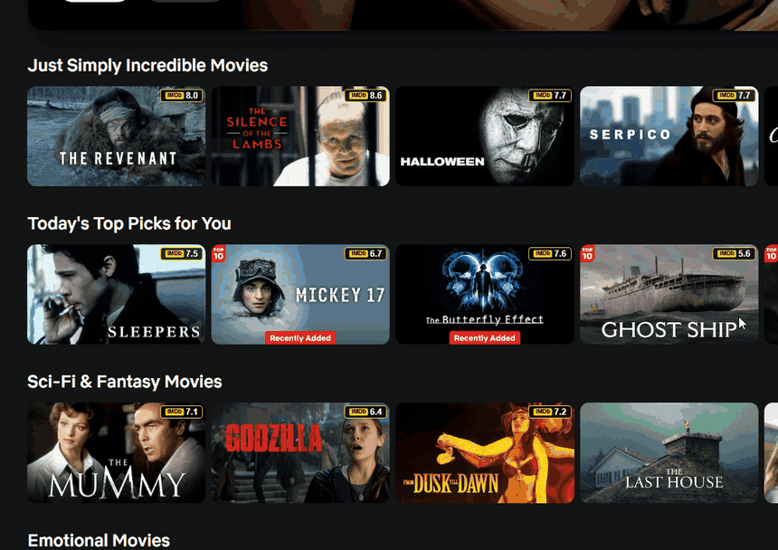

[English](README.md) | **Türkçe**

# Netflix IMDb Rating Extension



Netflix'te film ve dizi kartlarının üzerine IMDb puanını ekleyen bir Chrome eklentisi. Puanlar, IMDb'nin resmi veri setlerinden oluşturulan bir PostgreSQL veritabanından geliyor. Arada Redis önbelleği olan bir FastAPI servisi var.

## Erişim

Canlı API herkese açık değil. IMDb verisi yalnızca ticari olmayan kullanım için lisanslandığından, sağlık kontrolü dışındaki her endpoint bir API anahtarı istiyor ve eklenti dağıtılmıyor. Kendi kopyasını çalıştırmak isteyenin kendi backend'ini kurması ve IMDb veri setlerini kendisi indirmesi gerekiyor.

## Nasıl Çalışıyor?

```
Netflix Sayfası          Chrome Eklentisi            Backend API
┌──────────────┐      ┌──────────────────┐      ┌──────────────────┐
│              │      │                  │      │                  │
│  Film Kartı  │─────>│  content.js      │─────>│  FastAPI         │
│  (DOM)       │      │  Başlığı okur    │      │  /api/rating     │
│              │      │                  │      │  /api/ratings/   │
│  ┌────────┐  │      │  background.js   │<─────│   batch          │
│  │IMDb 8.7│  │<─────│  Puanı alır      │      │                  │
│  └────────┘  │      │  Rozeti ekler    │      │  PostgreSQL      │
│              │      │                  │      │  Redis           │
└──────────────┘      └──────────────────┘      └──────────────────┘
```

**Anasayfa kartları:** IntersectionObserver ekrana giren kartları yakalıyor. Başlıklar toplanıp Batch API'ye 20'şerli gruplar hâlinde gönderiliyor. Puan, posterin sağ üst köşesine küçük bir rozet olarak ekleniyor.

**Detay penceresi:** Bir filmin ya da dizinin detay penceresi açılınca (MutationObserver, 300 ms debounce) pencerenin içine büyük bir IMDb rozeti ekleniyor.

## Teknolojiler

| Kategori | Teknoloji | Neden |
|----------|-----------|-------|
| Backend | Python + FastAPI | Otomatik OpenAPI dokümantasyonu, Pydantic ile doğrulama |
| Veritabanı | PostgreSQL (Supabase) | İlişkisel veri, ücretsiz katman |
| Önbellek | Redis (Upstash) | Serverless Redis, Cache-Aside |
| Hosting | Vercel (Python serverless function) | Git entegrasyonuyla otomatik deploy |
| Eklenti | Chrome Manifest V3 | Service worker tabanlı güncel standart |
| Frontend | Vanilla JavaScript | Framework gerektirmiyor |
| Veri işleme | Pandas | Büyük IMDb TSV dosyalarını 100 bin satırlık parçalar hâlinde okuma |
| ORM | SQLAlchemy | Python'da standart ORM |

## Mimari

### Çok Katmanlı Önbellek

```
İstek geldi
    │
    v
┌─────────────────────────────┐
│ Katman 1: Bellek içi (Map)  │  5 dk TTL, en fazla 200 kayıt
│ background.js içinde        │
└──────────┬──────────────────┘
           │ MISS
           v
┌─────────────────────────────┐
│ Katman 2: Redis (Upstash)   │  1 saat TTL
│ Sunucu tarafında            │  Batch'te tek MGET
└──────────┬──────────────────┘
           │ MISS
           v
┌─────────────────────────────┐
│ Katman 3: PostgreSQL        │  Kalıcı depolama
│ (Supabase)                  │
└─────────────────────────────┘
```

- Kartlar ve detay penceresi aynı bellek içi önbelleği kullanıyor. Kartta sorulan bir filmin penceresi 5 dakika içinde açılırsa tekrar API'ye gidilmiyor.
- Manifest V3'te Chrome, boşta kalan service worker'ı kapatıyor. Kapandığında bellek içi önbellek de siliniyor ve istekler Redis'e düşüyor.
- `/api/cache/stats` içindeki hit/miss sayaçları her serverless instance'ın kendi belleğinde tutuluyor. Vercel birden fazla instance çalıştırabildiği ve instance'lar yeniden başlayabildiği için bu sayılar global değil. `total_keys` ise doğrudan Redis'ten okunuyor.

### Ölçümler

**Tarayıcıda:** Aynı film önce anasayfa kartında batch ile soruldu (PostgreSQL, ~100 ms). Detay penceresi açılınca puan bellek içi önbellekten geldi: **1.35 ms**.

**Canlı API** (Ekim 2026, istemciden uçtan uca, keep-alive bağlantı):

| İstek | Medyan | Ölçüm sayısı |
|-------|--------|--------------|
| `/api/rating`, Redis MISS (PostgreSQL) | 152 ms | 12 |
| `/api/rating`, Redis HIT | 93 ms | 22 |
| `/api/health` (karşılaştırma için) | 95 ms | 11 |

Süreler ağ gecikmesini de içeriyor. Redis HIT'in `/api/health` ile neredeyse aynı çıkması, Redis okumasının maliyetinin ağ gecikmesi yanında önemsiz kaldığını gösteriyor.

### Batch API

```
Öncesi:  GET  /api/rating?title=X   100 kart = 100 istek
Sonrası: POST /api/ratings/batch    100 kart = 5 istek (20'şerli)
```

- `content.js` görünen kartları kuyruğa alıyor. 300 ms içinde yeni kart gelmezse ya da kuyrukta 20 başlık birikirse istek gönderiliyor.
- `background.js` önce bellek içi önbelleğe bakıyor, API'ye sadece eksik başlıkları soruyor.
- Backend bir istekte en fazla 20 başlık kabul ediyor, 21 başlık 422 dönüyor. Önce tüm başlıklar için Redis'e tek bir `MGET` atılıyor. Redis'te olmayan başlıklar veritabanında tek tek sorgulanıp önbelleğe yazılıyor.

### Arama Nasıl Yapılıyor?

Full-text search kullanılmıyor. Başlıklar karşılaştırılmadan önce normalize ediliyor: küçük harfe çevriliyor ve Türkçe karakterler ASCII karşılıklarına dönüştürülüyor (`Başlangıç` → `baslangic`).

- **`/api/rating` ve batch:** Önce `movies` tablosunda `LOWER(title) = ?` ile tam eşleşme aranıyor. Birden fazla sonuç varsa en çok oy alan seçiliyor. Bulunamazsa Türkçe başlıkların tutulduğu `movie_titles` tablosunda `search_title` sütununda tam eşleşme aranıyor.
- **`/api/search`:** Aynı iki tabloda `LIKE '%sorgu%'` ile kısmi eşleşme aranıyor, sonuçlar uygulamada puana göre sıralanıyor.
- **`search_title`:** Türkçe başlıkların normalize edilmiş hâli. `scripts/add_search_titles.py` bu sütunu SQL `REPLACE` zinciriyle dolduruyor ve üzerine index ekliyor.

### Netflix DOM Entegrasyonu

Netflix kartlarda artık hash'li CSS sınıfları kullanıyor. Bu yüzden değişmeyen `data-uia` ve `aria-label` attribute'larına dayanılıyor.

| Bilgi | Seçici | Not |
|-------|--------|-----|
| Kart | `[data-uia="standard-card"]`, `[data-uia="ranked-card"]` | Normal ve Top 10 kartları. Eski düzen için `.slider-item` yedekte. |
| Kart başlığı | Kartın kendi `aria-label`'ı veya `a[aria-label]` | Yedek: `p.fallback-text` |
| Kart rozet alanı | `.boxart-container` | Yoksa karttaki `img`'nin üst elementi |
| Detay penceresi | `.previewModal--container`, `.detail-modal` | MutationObserver ile yakalanıyor |
| Pencere başlığı | `.previewModal--player-titleTreatment-logo` | Logonun `alt` metni. Sırayla denenen yedekler arasında `[data-uia="preview-modal-title"]` ve `.previewModal--info strong` var. |
| Pencere rozet alanı | `.previewModal--info` | |

**Kart tespiti:** IntersectionObserver (`threshold: 0.1`, `rootMargin: 50px`). Sonradan yüklenen kartlar MutationObserver ile gözlem listesine ekleniyor.

## Veritabanı

| Tablo | Kayıt | Açıklama |
|-------|-------|----------|
| movies | 59,980 | IMDb film ve dizileri (puan, oy sayısı, türler) |
| movie_titles | 23,976 | Türkçe başlıklar (IMDb akas, `region = TR`) |

**Kaynak:** IMDb resmi veri setleri (title.basics, title.ratings, title.akas)
**Filtre:** En az 1000 oy, sadece `movie`, `tvSeries` ve `tvMiniSeries`, yetişkin içerik hariç

## API

| Method | Endpoint | Açıklama |
|--------|----------|----------|
| GET | `/api/rating?title=X` | Tek başlık. İsteğe bağlı `year` parametresi alıyor, yanıtta `X-Cache: HIT/MISS` header'ı var. |
| POST | `/api/ratings/batch` | Toplu sorgu (en fazla 20 başlık) |
| GET | `/api/search?q=X` | Kısmi eşleşmeyle arama |
| GET | `/api/movie/{imdb_id}` | IMDb ID ile sorgu |
| GET | `/api/cache/stats` | Önbellek istatistikleri (hit/miss instance bazlı) |
| GET | `/api/health` | Sağlık kontrolü |

`/api/health` dışındaki her endpoint `X-API-Key` header'ı istiyor, geçerli bir anahtar olmadan gelen istekler 401 alıyor. Tarayıcı anahtarı gönderemediği için otomatik dokümantasyon (`/docs`) kapalı.

## Deployment

API, Vercel'de `lhr1` (Londra) bölgesinde Python serverless function olarak çalışıyor. Vercel Git entegrasyonu sayesinde `main`'e yapılan her push'ta otomatik deploy ediliyor. `vercel.json` bütün istekleri `api/index.py`'ye yönlendiriyor, bu dosya da `backend/` içindeki FastAPI uygulamasını dışa açıyor. Bağımlılıklar kökteki `requirements.txt`'ten kuruluyor. Geçerli API anahtarları Vercel'de `API_KEYS` ortam değişkeninde virgülle ayrılmış liste olarak duruyor. Böylece her kişiye ayrı anahtar veriliyor ve gerektiğinde tek biri iptal edilebiliyor.

## Proje Yapısı

```
netflix-imdb-extension/
├── api/
│   └── index.py                # Vercel giriş noktası
├── backend/
│   ├── app/
│   │   ├── models/
│   │   │   ├── movie.py        # Film modeli (SQLAlchemy)
│   │   │   └── movie_title.py  # Türkçe başlık modeli
│   │   ├── routes/
│   │   │   ├── movies.py       # Rating, batch, arama endpoint'leri
│   │   │   └── cache_routes.py # Önbellek istatistikleri
│   │   ├── utils/
│   │   │   ├── turkish.py      # Türkçe karakter normalizasyonu
│   │   │   └── cache.py        # Redis önbellek yardımcıları
│   │   ├── auth.py             # X-API-Key kontrolü
│   │   ├── main.py             # FastAPI uygulaması, route'lar
│   │   ├── config.py           # Ortam değişkenleri
│   │   ├── database.py         # SQLAlchemy bağlantısı
│   │   ├── redis.py            # Redis bağlantısı
│   │   └── schemas.py          # Pydantic şemaları
│   ├── requirements.txt
│   └── .env.example
├── extension/                  # Chrome eklentisi (Manifest V3)
│   ├── manifest.json
│   ├── config.example.js       # config.js şablonu (API adresi ve anahtar)
│   ├── content.js              # Netflix DOM'unu okur, rozetleri ekler
│   ├── background.js           # API istekleri ve bellek içi önbellek
│   ├── styles.css
│   ├── popup.html
│   └── popup.js                # API bağlantı durumu
├── scripts/
│   ├── import_imdb.py          # IMDb veri setleri -> PostgreSQL
│   ├── add_search_titles.py    # search_title sütununu doldurur
│   ├── test_db.py              # Veritabanını sorgulayan test scripti
│   └── requirements.txt
├── docs/
│   └── adr/                    # Mimari karar kayıtları (11 adet)
├── requirements.txt            # Vercel'in kurduğu bağımlılıklar
├── vercel.json
├── README.md
└── README.tr.md
```

## Mimari Kararlar (ADR)

| ADR | Karar |
|-----|-------|
| [ADR-001](docs/adr/ADR-001-postgresql-secimi.md) | Veritabanı olarak PostgreSQL |
| [ADR-002](docs/adr/ADR-002-fastapi-secimi.md) | Backend framework olarak FastAPI |
| [ADR-003](docs/adr/ADR-003-redis-cache.md) | Redis önbelleği (Upstash, Cache-Aside) |
| [ADR-004](docs/adr/ADR-004-imdb-dataset.md) | IMDb resmi veri setleri |
| [ADR-005](docs/adr/ADR-005-monorepo-yaklasimi.md) | Monorepo (backend ve eklenti aynı repoda) |
| [ADR-006](docs/adr/ADR-006-lokalize-baslik-destegi.md) | Türkçe başlık desteği (IMDb akas) |
| [ADR-007](docs/adr/ADR-007-arama-optimizasyonu.md) | Arama: normalizasyon ve tam eşleşme önceliği |
| [ADR-008](docs/adr/ADR-008-netflix-kart-ve-cache-stratejisi.md) | Netflix kartları ve önbellek stratejisi |
| [ADR-009](docs/adr/ADR-009-batch-api-kart-stratejisi.md) | Batch API ve IntersectionObserver |
| [ADR-010](docs/adr/ADR-010-railway-deployment.md) | Railway'de deployment (ADR-011 ile değiştirildi) |
| [ADR-011](docs/adr/ADR-011-vercel-deployment.md) | Railway'den Vercel'e geçiş |

## Bu Projede Öğrendiklerim

- **Backend:** REST API tasarımı, FastAPI, SQLAlchemy, Pydantic
- **Veritabanı:** PostgreSQL, Supabase, normalizasyon
- **Önbellek:** Redis, Cache-Aside, TTL, çok katmanlı önbellek, MGET
- **Deployment:** Vercel serverless, ortam değişkenleri
- **Chrome eklentisi:** Manifest V3, content ve background script, mesajlaşma API'si
- **Web API'leri:** IntersectionObserver, MutationObserver, DOM manipülasyonu
- **Performans:** Debounce, batch istekler, N+1 probleminin çözümü
- **Mimari:** ADR yazmak, YAGNI

## Veri ve Lisans

Bu, kişisel ve ticari olmayan bir eğitim projesi. IMDb verisi, IMDb'nin [ticari olmayan kullanım için sunduğu veri setlerinin](https://data.imdb.com/non-commercial-datasets/) koşulları altında kullanılıyor. Veri setleri bu repoda yer almıyor.

Information courtesy of IMDb (https://www.imdb.com). Used with permission.
